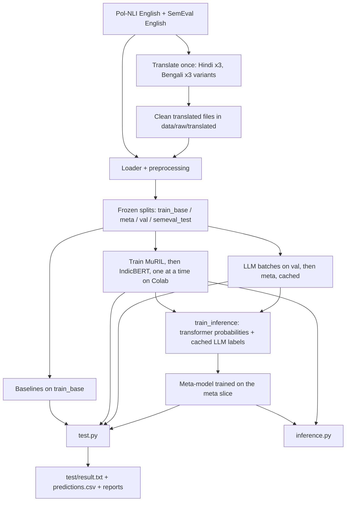
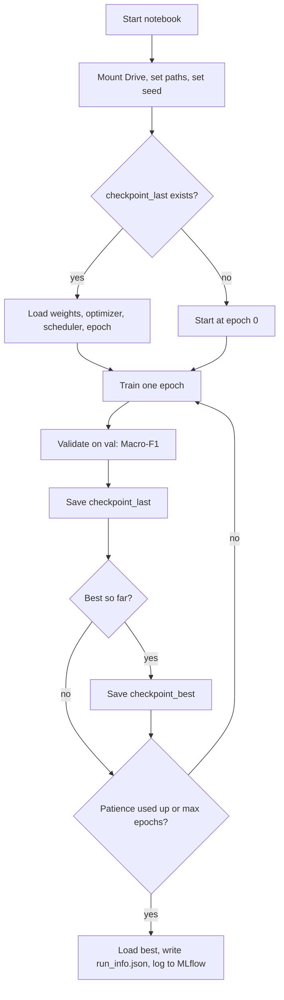
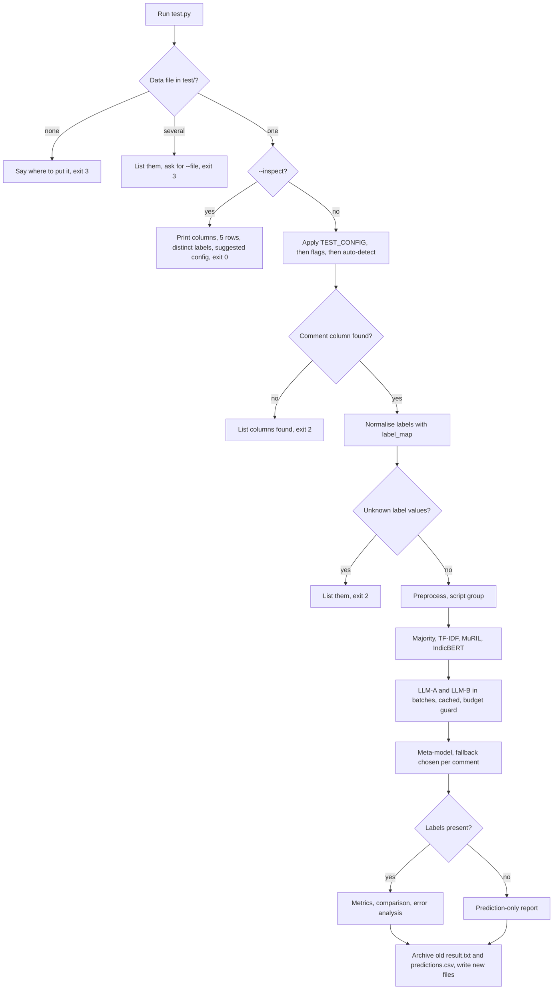

# App Flow

**Project:** EcoConsensus
**Version:** v2
**Companions:** `PRD.md`, `TRD.md`, `STACKING_ENSEMBLE.md`, `INFERENCE.md`, `TESTING.md`

There is no UI, so the "screens" are scripts and notebooks and the "clicks" are commands. For each step: what goes in, what happens, what comes next, and where you land when it fails.

---

## 1. Who walks which path

| Path | Person | Entry point |
|---|---|---|
| A. Build | You | `src/training/` scripts, Colab and Kaggle notebooks |
| B. Inference | Evaluator or you | `inference.py` |
| C. Evaluator test | Evaluator or you | `test.py` |
| D. Review | Anyone | `test/result.txt`, `outputs/`, MLflow UI, `docs/` |

## 2. Big picture



## 3. Path A: Build

### A1. Load and check the data
- **In:** `data/raw/original/` and `data/raw/translated/`.
- **What happens:** the loader maps columns (Pol-NLI `premise` → comment, `entailment` → label; SemEval `Tweet`, `Stance`), normalises labels, drops the `review` column, and prints counts.
- **Next:** A2.
- **If it fails:** a missing file or column stops the run and names it. A Bagheli file found in the data tree is reported and ignored.

### A2. Translated data check
- **In:** the Hindi and Bengali variant files.
- **What happens:** confirms 7 versions exist for every source row and that the row counts match; prints a random sample per variant for a manual look (stance kept, no English left over, script not broken).
- **Next:** A3.
- **If it fails:** missing versions are listed by source id. The request estimates in `STACKING_ENSEMBLE.md` assume all 7 exist.

### A3. Preprocess and split
- **In:** all rows.
- **What happens:** preprocessing (emoji kept, `@USER`, `URL`, NFC, noise list), then the split: Pol-NLI train → `train_base` + `meta`; Pol-NLI validation → `val`; SemEval → `semeval_test`.
- **Out:** `data/processed/` and a split report.
- **If it fails:** the script stops if a source id is in two splits. Re-creating existing splits needs `--overwrite-splits`.
- **Check for you:** read the split report; class ratios should be close in each split.

### A4. Baselines (Mac)
- **What happens:** majority and TF-IDF + logistic regression train on `train_base`; `val` tunes `C`.
- **Out:** `models/finetuned/baselines/` and MLflow runs.

### A5. Train the transformers (Colab or Kaggle, one at a time)
- **What happens:** `train_transformer.py --model muril`, then in a new session `--model indicbert`. LoRA, class weights, early stopping on `val`, checkpoint every epoch.
- **Out:** adapters in `models/finetuned/` and `run_info.json`.
- **If it fails:** a disconnect → rerun, it resumes from the last checkpoint. Out of memory → lower the batch size or max length.



### A6. LLM batches (anywhere with internet; can run while A5 trains)
- **What happens:** pilot on `val` to pick the batch size and the prompt; freeze the prompt; then `run_llm_batch.py` fills the cache for `meta` (then `semeval_test` later). Each request holds up to `LLM_BATCH_SIZE` comments.
- **If it fails:**
  - Daily budget reached → stops cleanly with "N comments still missing", resumes tomorrow from cache.
  - Missing or mismatched ids in a reply → those items are retried in a smaller batch, then singly, then marked `unavailable`.
  - Token-per-minute error → batch size is lowered for that provider and the script waits.
  - Missing key → stops at once and names the `.env` variable.

### A7. Build features and the meta-model
- **What happens:** `train_inference.py` runs both transformers on `meta`, `val` and `semeval_test` and joins the cached LLM labels. `train_meta.py` fits the meta-model and the three fallback variants on `meta`, and compares with voting.
- **Out:** feature tables in `outputs/predictions/`, models in `models/finetuned/meta/`.

## 4. Path B: `inference.py`

```mermaid
flowchart TD
    S[Run inference.py] --> A{--text or --file?}
    A -- neither --> E1[Print usage, exit 2]
    A -- --text --> P[One-row table]
    A -- --file --> L[Flexible loader]
    L --> C{Comment column found?}
    C -- no --> E2[List columns found, exit 2]
    C -- yes --> P
    P --> T[Preprocess]
    T --> U{Empty after cleaning?}
    U -- yes --> U1[Flag row, warn, skip]
    U -- no --> V[MuRIL + IndicBERT]
    V --> W[LLM-A and LLM-B: one comment each]
    W --> X{All components available?}
    X -- yes --> Y[meta_all4]
    X -- no --> Z[Matching fallback variant]
    Y --> O[Final label]
    Z --> O
    O --> N[Print result, write log and predictions]
```

What you see for one comment:

```text
Comment : <text>
Claim   : Climate change and global warming is a serious concern.
Final   : Favour | None | Against
Votes   : MuRIL=…  IndicBERT=…  LLM-A=…  LLM-B=…
Mode    : meta_all4   (or: meta_no_llm_b — LLM-B unavailable)
Log     : outputs/logs/inference_<timestamp>.txt
```

| Situation | What happens |
|---|---|
| File not found | Message with the path tried, exit 2 |
| Unreadable or unknown columns | Message listing columns found and the accepted names |
| No label column | Prediction-only; no metrics |
| Unknown label spellings | Values listed; stops unless `--allow-unknown-labels` |
| Empty comment | Row flagged and skipped, counted |
| Missing API key | That LLM is skipped; fallback variant used; warning shown |
| LLM error or rate limit | Retries, then fallback variant for that comment |
| Adapter files missing | Message names the folder expected, exit 4 |
| Very long comment | Truncated to 128 tokens; the log notes it |
| Language other than Hindi, Bengali, English | Still processed; no language gate |

## 5. Path C: `test.py`



**Output files**

| File | What it is | Overwrite rule |
|---|---|---|
| `test/result.txt` | The full report (latest) | Previous file moved to `test/archive/result_<time>.txt` first |
| `test/reports/result_<time>.md` | The same report in Markdown | Timestamped, never reused |
| `test/predictions.csv` | `ID`, `Predicted_Label` (the PS prediction file) | Previous file moved to `test/archive/` first |
| `outputs/logs/test_<time>.txt` | Run log | Timestamped |
| `outputs/predictions/test_<time>_detailed.csv` | Every component's output per comment | Timestamped |
| `outputs/metrics/test_<time>.json` | Numbers behind the report | Timestamped |
| `outputs/cache/` | LLM answers per comment | Appended only |

| Situation | What happens |
|---|---|
| File in an unexpected format | Tries other delimiters and encodings; if all fail, says which were tried, exit 3 |
| Wrong columns picked by auto-detect | `--inspect` shows the guess; set `TEST_CONFIG` or use flags |
| Numeric labels with no map | Stops and shows the distinct values; you set `label_map` |
| No labels in the file | Prediction-only report; no metrics |
| Daily LLM budget reached | Remaining comments use a fallback variant; the report states how many |
| No LLM keys | Runs transformers + baselines only; report says so |
| Model files missing | Names the missing folder, exit 4 |
| An LLM batch fails after retries | Those comments are `unavailable` for that LLM; fallback variant used |

## 6. Path D: Review

1. Read `test/result.txt` (or the `.md` copy).
2. Open MLflow: `mlflow ui --backend-store-uri sqlite:///outputs/metrics/mlflow.db`.
3. Check `outputs/logs/` for any run's exact inputs and warnings.
4. Read the README for how to reproduce each step.

## 7. Dead ends avoided

- A stage cannot start without its inputs; the message names the stage that creates them.
- Splits are never regenerated silently.
- No script writes into an existing report; old reports are archived or kept by timestamp.
- Every failure message names the file, column, key or stage involved and says what to do next.
