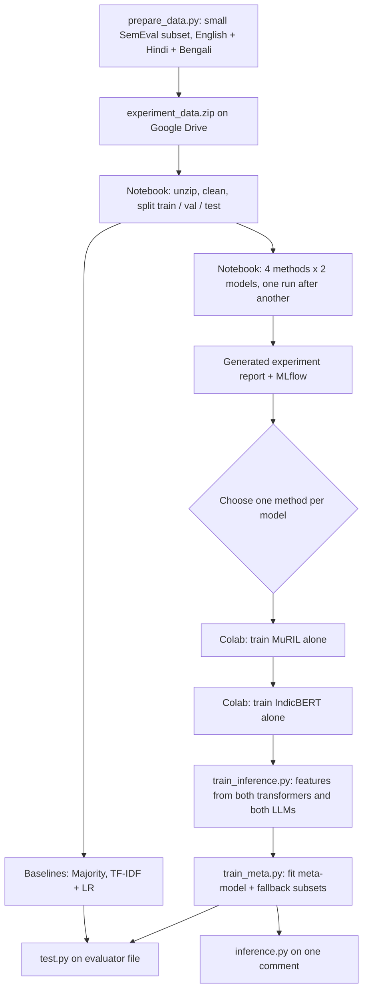
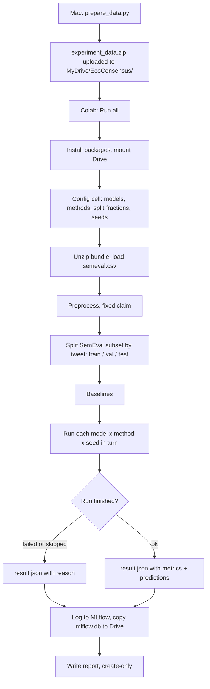
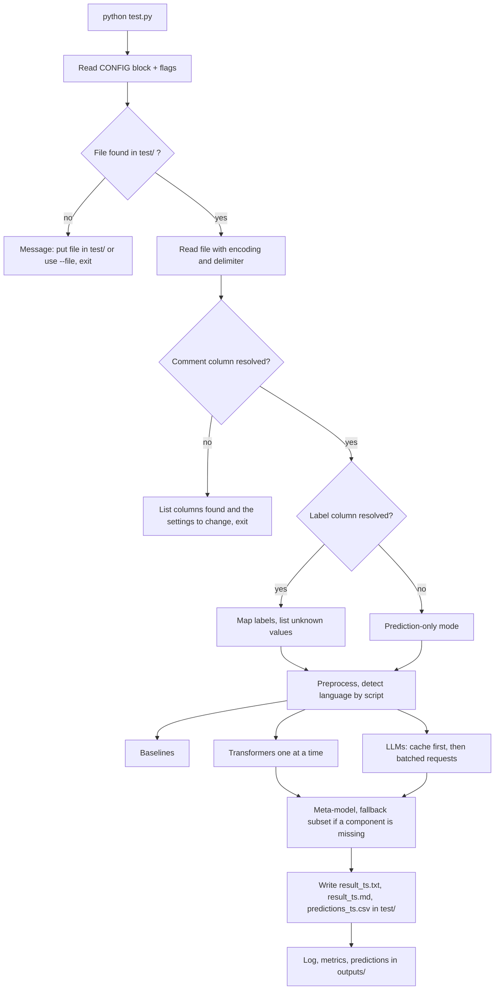
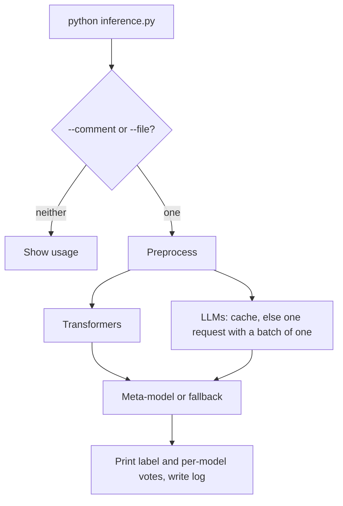

# App Flow

**Companion to:** PRD.md, TRD.md, STACKING.md
**Version:** 2

There is no UI. The "screens" are scripts and notebooks; the "clicks" are commands and stage hand-offs. For each path: what goes in, what happens, what comes next, and where someone lands when something goes wrong.

## 1. Paths

| Path | Who | Entry |
|---|---|---|
| A. Experiment | Builder | `experiment/experiment.ipynb` on Colab or Kaggle |
| B. Final build | Builder | `src/training/*` on Colab, then Mac |
| C. Evaluation | Evaluator | `test.py` |
| D. Single comment | Anyone | `inference.py` |
| E. Review | Reader | `experiment/reports/`, MLflow, `test/`, `outputs/` |

## 2. Whole project

## 3. Path A: Experiment notebook

- **Input:** `experiment_data.zip` made by `prepare_data.py` (see `experiment/SETUP.md`).
- **If a translated file is not row-aligned or a column is missing:** `prepare_data.py` stops and names the file and the columns it found.
- **If the zip is not found:** the notebook stops with a message naming the paths searched.
- **If the session disconnects:** run all again; splits are reused, finished runs are skipped, an interrupted run starts again.
- **If a run runs out of memory:** it retries once with half the batch size; if that fails it is marked failed and the report lists it.
- **If QLoRA cannot install or run:** its runs are marked skipped and the report lists them.
- **Output (on Drive):** `experiment_outputs/reports/experiment_report_<timestamp>.md`, `mlflow.db`, `mlartifacts/`, `results/`, `predictions/`, `splits/`.

## 4. Path B: Final build

| Step | Command | Output | If it fails |
|---|---|---|---|
| B1 | `train_transformer --model muril --method <chosen>` | `models/finetuned/muril__<m>/` | Rerun the same command; resumes from last epoch |
| B2 | `train_transformer --model indicbert --method <chosen>` (after B1 exits) | `models/finetuned/indicbert__<m>/` | Same |
| B3 | `train_inference` | `outputs/features/<split>__<component>.csv` | Rerun; finished components and cached LLM entries are skipped; daily limit stops cleanly |
| B4 | `train_meta` | `models/finetuned/meta/`, report in `outputs/metrics/` | Message lists the missing feature files |

Why separate steps: Colab VRAM is about 15 GB, so the two transformers never share the GPU; each step saves its own result so a dropped session loses little.

## 5. Path C: `test.py` (evaluator)

- **Switching to the evaluator's data on the spot:** open `test.py`, edit the CONFIG block (about five lines: column names, label map, claim mode), or pass the same settings as flags. Nothing else changes.
- **What the evaluator sees:** progress lines, then the path of the report and prediction file, then a short comparison table.
- **Output files (never overwritten, timestamped):**
  - `test/result_<timestamp>.txt` and `.md`: dataset summary, per-system metrics (Macro-F1, accuracy, precision, recall, per-class, confusion matrix, per language), ranking, fallbacks used, warnings, runtime, errors list
  - `test/predictions_<timestamp>.csv`: `ID,Predicted Label`
  - `outputs/logs/`, `outputs/metrics/`, `outputs/predictions/`
- **Where things land when something goes wrong:**

| Situation | Result |
|---|---|
| No file in `test/` | Message, nothing written |
| Column names do not match | Message lists columns found and which setting to edit |
| Labels in unknown spelling or numbers | Values listed; those rows are predicted but not scored; report says how many |
| Labels all missing | Prediction-only mode, no metrics |
| Empty comment | Predicted `neutral`, listed in warnings |
| LLM key missing or limit reached | Fallback meta-model, named in report; cached entries still used |
| Model weights missing | Message names the folder and the build step that creates it |
| Very long comment | Truncated to the model length; counted in warnings |
| A report with the same name exists | New file gets a numeric suffix; old file untouched |

## 6. Path D: `inference.py`

Screen output for one comment: comment, claim, final label, per-model votes, which ensemble was used, log path. Details and all flags: `docs/INFERENCE.md`.

## 7. Path E: Review

1. Experiment: open the newest file in `MyDrive/EcoConsensus/experiment_outputs/reports/`; download `mlflow.db` from that folder and open it with `mlflow ui --backend-store-uri sqlite:///mlflow.db`.
2. Evaluation: open the newest `test/result_*.md`.
3. Logs: `outputs/logs/`.

## 8. Checks that prevent dead ends

- Every stage names the previous stage when its input is missing.
- Splits are never regenerated silently; the split ids are saved with a seed.
- SemEval test is read only by the final comparison and `test.py`.
- Every error message names the file, column, key or step, and what to do next.
