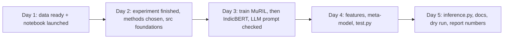

# Implementation Plan

**Duration:** 5 days
**Companion to:** PRD.md, TRD.md, APP_FLOW.md, STACKING.md
**Version:** 2

The work is in two phases. **Phase 1 (experiment)** ends with a chosen fine-tuning method per model. **Phase 2 (build)** writes `src/`, `test.py`, `inference.py` only after that choice. Each stage lists what it delivers, a sign-off, and a cut-line (what to drop first when behind).

Status key: ☐ not started · ◐ in progress · ☑ signed off

## Timeline

Things that run while you wait: Bengali translation (API) during Day 1; LLM feature requests on Day 3 and 4 while GPU steps run.

## Stage 1 (Day 1): Data ready and experiment launched ☐

| Task | Output |
|---|---|
| Translate Pol-NLI and SemEval to **Bengali** (pure, code-mix, romanised), one row per English row in the same order (done) | `data/raw/translated/Bengali/...` |
| Build the experiment bundle (SemEval subset, English + 3 Hindi + 3 Bengali variants) and upload it to Drive | `python experiment/prepare_data.py` → `experiment_data.zip` |
| Spot-check about 20 rows per language and variant: stance preserved, no English leftovers, script correct | Short notes |
| Run the notebook on a tiny setting first (`SEEDS = [42]`, `EPOCHS = 1`, one method) | Proof that the pipeline runs end to end |
| Run the full notebook on Colab | Runs in progress |
| Write `.gitignore`, `.env.example`, folder skeleton | Clean repo start |

**Sign-off:** `prepare_data.py` alignment checks pass; class table shows 7 language/variant groups with equal ratios; baseline numbers present; runs started.
**Cut-line:** use one seed and fewer methods; finished runs are kept when you rerun.

## Stage 2 (Day 2): Experiment finished, methods chosen, foundations ☐

| Task | Output |
|---|---|
| Read the generated report; add a third seed for close calls | `experiment_outputs/reports/experiment_report_*.md` and `mlflow.db` on Drive |
| Choose one method per model by the report's rule; record in TRD decision log | Decision |
| Write `config.py`, `preprocessing.py`, `data_loading.py`, `metrics.py`, `reporting.py` (create-only writer) with tests | Tested foundations |
| Write the LLM system prompt check: run 50 dev comments through both providers | Parse rate and label sanity |

**Sign-off:** a method per model is chosen with a written reason; preprocessing and reporting tests pass; the report writer refuses to overwrite.
**Cut-line:** skip the second seed; choose on one seed and say so.

## Stage 3 (Day 3): Final training, one model at a time ☐

| Task | Output |
|---|---|
| Write `src/training/train_transformer.py`, `methods.py`, `checkpointing.py` (reuse the notebook worker) | Training code |
| Train **MuRIL alone** on Colab; wait for exit | `models/finetuned/muril__<m>/` |
| Train **IndicBERT alone** | `models/finetuned/indicbert__<m>/` |
| Write `llm_api.py` (interface, batching, cache, retry, parser) and run LLM A over SemEval dev | Cache filling |

**Sign-off:** both checkpoints saved with `run_info.json`; interrupted-run resume tested once; LLM cache grows and a rerun makes zero new requests for cached rows.
**Cut-line:** use fewer epochs (early stopping stays); use fewer dev rows for LLM features.

## Stage 4 (Day 4): Features, meta-model, `test.py` ☐

| Task | Output |
|---|---|
| Write and run `train_inference.py` (transformer features one model at a time; LLM A and B features) | `outputs/features/*.csv` |
| Write and run `train_meta.py` (grouped CV, 15 subset models, report) | `models/finetuned/meta/`, meta report |
| Write `test.py` with CONFIG block, flags, reports in `test/` | Working evaluator entry point |
| Test `test.py` on **three fake formats** (SemEval-style columns, `text,label` with numbers, no labels) | Passing checks |
| Run SemEval **test** once through `test.py` for the headline table | Comparison table |

**Sign-off:** features cover all dev rows (or the shortfall is documented); meta-model beats or is compared honestly with voting; `test.py` works after changing only the CONFIG block; test split used once.
**Cut-line:** drop the 15 subset models to four (full, no LLM A, no LLM B, transformers only); skip per-language plots.

## Stage 5 (Day 5): `inference.py`, documentation, dry run ☐

| Task | Output |
|---|---|
| Write `inference.py` | Working CLI |
| Write README references and `docs/INFERENCE.md` checks on macOS (and Windows or Linux if you can) | Verified commands |
| Fresh clone and virtual environment, follow README only | Verified instructions |
| Gather numbers for the 8-page report from generated reports | Report inputs |
| Prediction file for the assignment's hidden test (when it arrives) | `ID,Predicted Label` file |
| Buffer | None, ideally |

**Sign-off:** `inference.py` works with and without API keys; README reproduces the baselines; report numbers each trace to a generated file.
**Cut-line:** skip optional bonus items (explainability); never skip the dry run.

## Progress rules

- A stage is done only when its sign-off is complete.
- If a stage slips by half a day, apply its cut-line that day.
- Record plan changes in the TRD decision log.
- Reports are never edited by hand; rerun to regenerate (old ones stay).

## Risks by day

| Day | Risk | Early sign | Response |
|---|---|---|---|
| 1 | Translated row order differs from English | `prepare_data.py` alignment check stops | Retranslate that file; keep order |
| 1 | Colab or Kaggle quota | Session ends | Run all again; finished runs are skipped |
| 2 | Methods within noise | Gaps of a few points | Second seed; prefer fewer trainable parameters |
| 3 | Colab memory | Out-of-memory | Lower batch; one model per process |
| 3 | LLM daily limit | Stop message | Continue next day from cache |
| 4 | Stacking no better than voting | CV table | Report honestly |
| 5 | Evaluator format surprises | Loader error | Edit CONFIG block; add alias |

## Open items

1. Bengali translations (not yet created).
2. Two LLM providers and models.
3. Hidden test file date and format (unknown by design).
