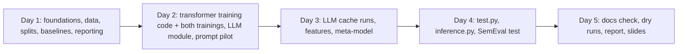

# Implementation Plan

**Project:** EcoConsensus
**Version:** v2
**Duration:** 5 days, Mon 9 Nov – Fri 13 Nov 2026 (shift all dates if the course announces different ones)
**Companions:** `PRD.md`, `TRD.md`, `APP_FLOW.md`, `STACKING_ENSEMBLE.md`

Each stage lists what it delivers and what you sign off before the next one starts. Each stage has a **cut-line**: what to drop first if you fall behind, so the core always works.

**Status key:** ☐ not started · ◐ in progress · ☑ signed off

---

## Stage 0: Experiment ☑ (done, report of 2026-11-08)

- Method comparison on the SemEval subset (300 tweets × 7 versions, 2 seeds): head only, last 2, last 4, LoRA, QLoRA.
- Result: LoRA recommended for MuRIL and IndicBERT; QLoRA failed in all four runs (reported as not run).
- Tested environment: Python 3.13.16, transformers 5.22.2, torch 2.14.1, peft 0.21.2.
- Output: `experiment/experiment_outputs/` (report, results, predictions, MLflow database).

Carry-over to the build: the weak `against` class (IndicBERT/LoRA scored 0.044 F1 on `against` in the held-out check), and the fact that SemEval was used to choose methods (say so in the report).

---

## Critical path

Parallel work: LLM requests are limited per day, so start them as early as the prompt is frozen (end of Day 2) and let them run in the background while other work continues. Transformer training on Colab also runs while you code.

---

## Day 1 (Mon): Foundations, data, splits, baselines ☐

**Where:** Mac

| Task | Output |
|---|---|
| Create the layout from `TRD.md`, `requirements.txt`, `.gitignore`, `.env.example`, config files | Project skeleton |
| `config.py`, `utils.py` (seeds, logging, `safe_write`) | Shared helpers |
| `data_loading.py` (flexible loader, aliases, label map) with tests on fake files | Loader |
| `preprocessing.py` (emoji kept, `@USER`, `URL`, NFC, noise list incl. `#SemST`) with tests | Cleaning function |
| Check the translated data: 7 versions per row, row counts, Bengali replaced Bagheli, remove Bagheli from the tree, manual sample | Data check printout |
| `splitting.py`: `train_base` / `meta` / `val` / `semeval_test`, grouped by source id | `data/processed/` + split report |
| `metrics.py` (Macro-F1 first, full set, by script group, bootstrap interval) with tests | Metrics module |
| `reporting.py` skeleton: `safe_write`, archive logic, report sections | Reporting module |
| `baselines.py`: majority and TF-IDF + logistic regression; MLflow logging | Baseline numbers on `val` and `semeval_test` |
| Read the cleaned data once: class counts, comment lengths, hashtags, emojis, duplicates | Short data summary |

**Delivers:** a working data pipeline, frozen splits, baselines, and the reporting skeleton.

**Sign-off checklist**
- [ ] Loader and preprocessing tests pass (emoji, handle, URL, Hindi, Bengali, empty text, `#SemST`).
- [ ] All 7 versions exist for every source row, or the gaps are listed.
- [ ] Split report: near-equal class ratios; no source id in two splits.
- [ ] Majority and TF-IDF results are logged.
- [ ] A second `result.txt` write archives the first (unit test).

**Cut-line:** drop the bootstrap interval and the by-variant breakdown for now (keep Macro-F1, accuracy, per-class, confusion matrix, by script group).

---

## Day 2 (Tue): Transformer training and the LLM module ☐

**Where:** Mac for code, Colab or Kaggle for training

| Task | Output |
|---|---|
| `src/training/train_muril.ipynb` and `train_indicbert.ipynb` (self-contained): sentence-pair dataset, LoRA, class weights, AdamW, early stopping, checkpoint and resume, probabilities for `meta`/`val`/`semeval_test` | Two runnable notebooks |
| Train **MuRIL** and **IndicBERT** at the same time on two Colab accounts; download both `<model>_results.zip` | Two adapters in `models/finetuned/`, probabilities in `outputs/<model>/predictions/` |
| `llm_api.py`: adapters, batching, id check, retries, per-comment cache, daily budget guard, token-limit backoff, parser tests | Tested module |
| Write the `.env` with real keys for two providers; check each answers a 3-comment test | Providers working |
| **Batch-size pilot** (100 `val` comments at batch 10, 25, 50, 100) and **prompt choice** (zero-shot vs few-shot) on `val` | `LLM_BATCH_SIZE` and the prompt version chosen |
| **Freeze the prompt** (end of day) | Version tag in `llm.yaml` |

**Delivers:** two trained transformers, a tested LLM module, a frozen prompt, and a chosen batch size.

**Sign-off checklist**
- [ ] A deliberately interrupted training run resumes from its checkpoint.
- [ ] Both adapters saved with `run_info.json` and an MLflow run id.
- [ ] Pilot table exists; batch size chosen with no missing ids.
- [ ] Prompt is frozen and no `semeval_test` row has been sent to any LLM yet.
- [ ] Cache key ignores batch size (unit test).

**Cut-line:** one seed per transformer instead of two; skip few-shot and use the zero-shot prompt if the pilot shows no gain.

---

## Day 3 (Wed): LLM cache runs, features, meta-model ☐

**Where:** anywhere with internet for LLM runs, Colab for features, Mac for the meta-model

| Task | Output |
|---|---|
| `run_llm_batch.py` for both providers on `meta` (then `val` if not covered); resume across days if the cap is low | Filled cache for `meta` |
| Start `semeval_test` LLM runs in the background once `meta` is done | Cache for `semeval_test` (can finish on Day 4) |
| `train_inference.py`: both transformers on `meta`, `val` and `semeval_test`, join cached LLM labels | Feature tables |
| `ensembling.py` and `train_meta.py`: grouped cross-validation on `meta`, final fit, fallback variants, comparison with voting, saved weights | Meta-models in `models/finetuned/meta/` |
| Log everything to MLflow (`stacking`) | Traceable choices |

**Delivers:** a trained, saved meta-model with fallbacks.

**Sign-off checklist**
- [ ] LLM parse-error and `unavailable` rates are low and known per provider.
- [ ] No `val` or `semeval_test` row in the meta training table (script check).
- [ ] Meta-model compared with best single transformer, best single LLM and simple voting.
- [ ] Meta-model weights printed and sensible.
- [ ] All four variants saved.

**Cut-line:** if quota runs short, send only 3 versions per `meta` comment (English + one Hindi + one Bengali variant) and say so in the report; a 10% hold-out also works.

---

## Day 4 (Thu): `test.py`, `inference.py`, SemEval test ☐

**Where:** Mac

| Task | Output |
|---|---|
| `pipeline.py`: shared code that runs components on rows, picks the fallback per comment | Shared module |
| `test.py`: file discovery, `TEST_CONFIG`, flags, `--inspect`, label map, run, report, prediction file, archive | Working test runner |
| Report sections: comparison, per-class, confusion matrices, by script group, LLM usage, error analysis, explainability, environment, configuration | `result.txt` and `.md` |
| Run `test.py` on SemEval (copy it into `test/` as a stand-in evaluator file) | First full comparison |
| Try odd files: renamed columns, TSV, XLSX, numeric labels, no labels, no claim column, one with Latin-only text | Passing checks |
| `inference.py`: one comment and file modes, flags from `INFERENCE.md` | Working CLI |

**Delivers:** the headline comparison and both entry points.

**Sign-off checklist**
- [ ] `test.py --inspect` shows columns, sample rows and distinct labels.
- [ ] A new `TEST_CONFIG` for a differently named file works in under a minute.
- [ ] `result.txt` shows majority, TF-IDF, MuRIL, IndicBERT, best transformer, LLM-A, LLM-B, best LLM and the ensemble.
- [ ] `predictions.csv` has `ID` and `Predicted_Label` for every row.
- [ ] Running twice keeps the first report in `test/archive/` and `test/reports/`.
- [ ] `semeval_test` was used only for this comparison.
- [ ] If the ensemble does not beat the best single model, the report says so plainly.

**Cut-line:** drop the bootstrap interval and the misclassified-examples list beyond the top 20.

---

## Day 5 (Fri): Documentation, dry runs, report, slides ☐

| Task | Output |
|---|---|
| README (setup on macOS, Linux, Windows; run each stage; limitations; machine-translation note; every source cited) | README |
| Check `INFERENCE.md`, `TESTING.md` and `REFERENCES.md` against the real code and flags; fix differences | Matching docs |
| Add the name of the translation LLM and the two classification LLMs to `REFERENCES.md` | Complete citations |
| Dry run as the evaluator: fresh clone, fresh environment, README only, a surprise test file | Verified instructions |
| Run at least once on macOS and once on Linux (Colab shell counts); follow the Windows steps in `INFERENCE.md` if a Windows machine is available | OS check |
| 8-page technical report from the generated reports (Introduction, Dataset, Methodology, Experiments, Results, Error Analysis, Conclusion, References) | Report PDF |
| Slides (if applicable) | Slide deck |
| Buffer | None, ideally |

**Sign-off checklist**
- [ ] `test.py` runs from a fresh clone on a file with unknown columns after a config change only.
- [ ] No key appears in the repo or logs.
- [ ] README steps reproduce the baselines.
- [ ] The report states the limitations (translation, small `against` class, domain gap).

**Cut-line:** skip extra polish. Never skip the dry run.

---

## Day-by-day summary

| Day | You can say at the end |
|---|---|
| Mon | "Data, splits and baselines work" |
| Tue | "Both transformers are trained and the LLM prompt is frozen" |
| Wed | "The meta-model is trained" |
| Thu | "`test.py` and `inference.py` work and I have the comparison" |
| Fri | "Someone else can run it, and the report is written" |

## Progress rules

- A stage is done only when its sign-off checklist is complete.
- If a stage slips by more than half a day, apply its cut-line the same day.
- Record every plan change in the TRD decision log.
- Commit at the end of every stage with a message naming it.

## Risks by day

| Day | Main risk | Early warning | Response |
|---|---|---|---|
| 1 | A translated variant is missing or broken | Row counts differ | Fix before splitting; list gaps |
| 2 | Colab GPU quota or disconnects | Runs stop mid-epoch | Resume from checkpoint; train the second model next session |
| 2 | Big batches skip items | Missing ids in the pilot | Choose a smaller batch |
| 3 | LLM daily cap | "Rate limit" or budget stops | Resume tomorrow; apply the cut-line |
| 4 | Ensemble does not beat the best single model | Meta ≈ best single | Report honestly; analyse per class |
| 4 | Unknown test format breaks the demo | Loader error on odd files | Add an alias; practise `--inspect` |
| 5 | Docs differ from code | Dry run fails | Fix the docs, not the memory |

## Open items to settle on Day 1

1. Which two LLM providers and models.
2. Which LLM made the translations (name it in the README).
3. Whether the report must follow a template.
4. Hashtag handling after reading the cleaned data.
